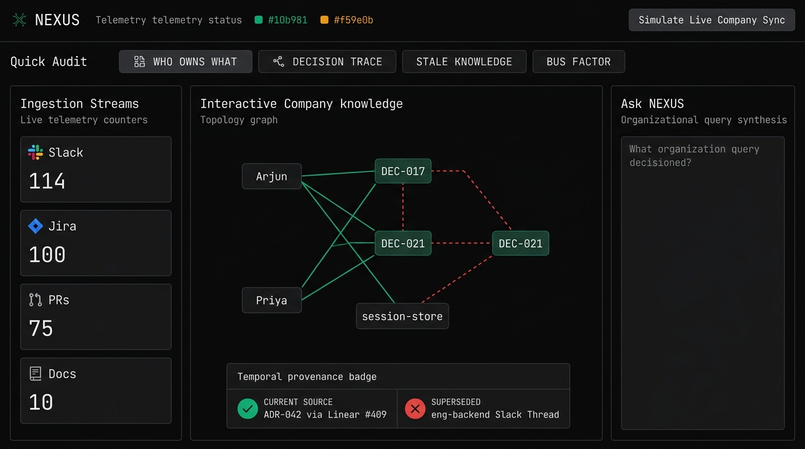
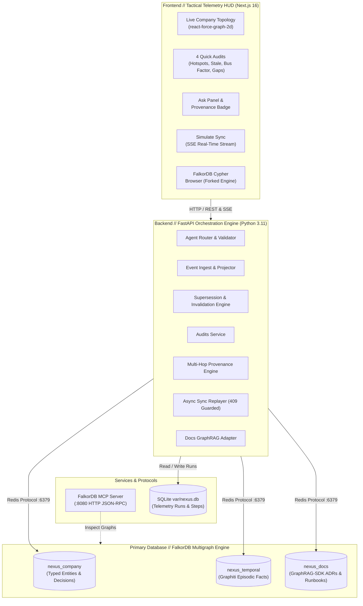
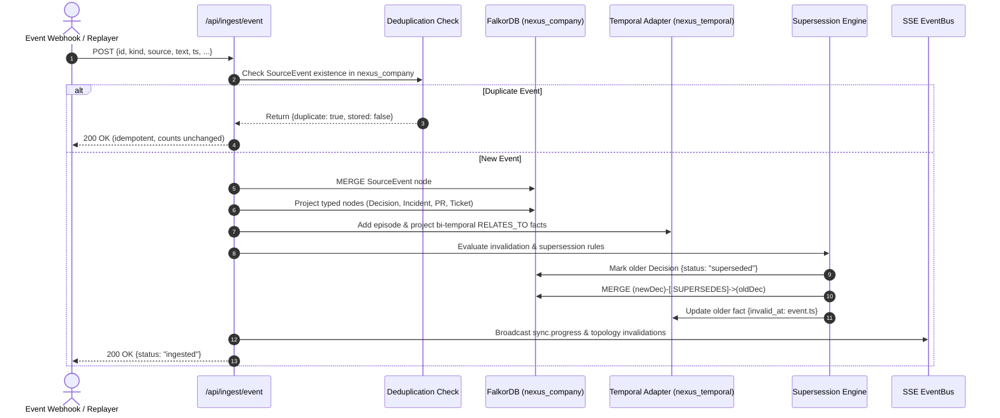
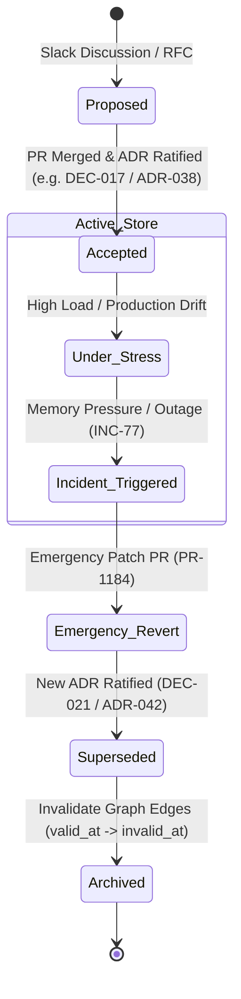

# NEXUS // Organizational Telemetry & Decision Graph

> **Track 03 — Company Brain:** A unified multi-graph telemetry engine in FalkorDB that continuously ingests Slack, Linear, GitHub, Incidents, and ADRs into a temporal decision graph, tracks decision supersession, audits organizational risks, and powers audit-provenance question answering without stale LLM hallucinations.



---

## 1. Executive Summary & Track 03 Mapping

Modern engineering organizations make hundreds of distributed technical decisions across Slack threads, Linear tickets, pull requests, incidents, and architectural decision records (ADRs). When teams scale or rotate, organizational knowledge fragments: questions like *"Where do we store user sessions?"* or *"Why did we stop using Redis?"* cause flat vector search systems and RAG pipelines to return **superseded, dangerously stale answers** (e.g., citing a months-old migration to Redis without knowing that a subsequent production incident and ADR reversed the decision back to Postgres).

**NEXUS** solves this with an authoritative, bi-temporal, multi-graph architecture in **FalkorDB**:
- **Live Company Topology:** Ingests people, services, teams, tickets, incidents, and decisions into `nexus_company`.
- **Temporal Memory:** Ingests episodic events and maintains bi-temporal validity (`valid_at`, `invalid_at`) in `nexus_temporal` via Graphiti.
- **Decision Supersession Lifecycle:** Tracks explicit `SUPERSEDES` and `INVALIDATES` relationships, invalidating superseded decisions (e.g., DEC-017 / ADR-038 invalidated by INC-77 & PR-1184 and replaced by DEC-021 / ADR-042).
- **Tactical Industrial HUD:** Real-time visual canvas built on Next.js and `react-force-graph-2d` showing active links (green) vs superseded links (red dashed), 4 Quick Audits, Ask agent with verified provenance badges, and a live sync simulator.

### Track 03 Key Focus Mapping

| Track 03 Key Focus Area | NEXUS Implementation Feature | Core Implementation Path |
|---|---|---|
| **1. Unified Knowledge Multi-Graph** | Multi-graph architecture isolating enterprise entities (`nexus_company`), temporal memory (`nexus_temporal`), and technical docs (`nexus_docs`) with full tenant isolation (`org_id`). | [`api/nexus_api/adapters/falkor.py`](api/nexus_api/adapters/falkor.py)<br>[`api/nexus_api/cypher/schema.cypher`](api/nexus_api/cypher/schema.cypher) |
| **2. Cross-Source Correlation & Event Ingestion** | Asynchronous ingestion pipeline projecting Slack threads, Linear tickets, GitHub PRs, PagerDuty incidents, and ADRs into typed nodes with deterministic deduplication and provenance back-links. | [`api/nexus_api/services/ingest.py`](api/nexus_api/services/ingest.py)<br>[`api/nexus_api/services/projector.py`](api/nexus_api/services/projector.py) |
| **3. Temporal Graph & Decision Supersession** | Explicit state tracking for decision lifecycles (`proposed` → `accepted` → `superseded` → `deprecated`). Automatically detects reversals from incidents and updates temporal edges with `invalid_at` timestamps. | [`api/nexus_api/services/supersession.py`](api/nexus_api/services/supersession.py)<br>[`api/nexus_api/adapters/temporal.py`](api/nexus_api/adapters/temporal.py) |
| **4. Operational Audits & Governance** | 4 sub-second Cypher queries: Stale Decisions, Single Points of Failure / Bus Factor = 1, Orphan Services / Ownership Gaps, and Incident Hotspots. | [`api/nexus_api/cypher/audits.cypher`](api/nexus_api/cypher/audits.cypher)<br>[`api/nexus_api/services/audits.py`](api/nexus_api/services/audits.py) |
| **5. GraphRAG Question Answering & Provenance** | Agent router and answer synthesizer with multi-hop Cypher traversal, temporal validation, hallucination elimination, and verified provenance badges. | [`api/nexus_api/services/ask_agent.py`](api/nexus_api/services/ask_agent.py)<br>[`api/nexus_api/services/provenance.py`](api/nexus_api/services/provenance.py)<br>[`web/components/nexus/ProvenanceBadge.tsx`](web/components/nexus/ProvenanceBadge.tsx) |

---

## 2. System Architecture



---

## 3. Ingest Pipeline & Decision Supersession Lifecycle

### Ingestion & Graph Projection Pipeline



### Decision Supersession Lifecycle State Machine



---

## 4. FalkorDB Multigraph Usage & Cypher Implementation

NEXUS exclusively uses **FalkorDB** as its primary graph engine, maintaining clean multi-tenant isolation via `org_id` properties across three dedicated graphs:

| Graph Name | Purpose | Node Types | Edge Types | Cypher Source |
|---|---|---|---|---|
| `nexus_company` | Authoritative organization ontology, current infrastructure topology, and technical decisions. | `:Person`, `:Team`, `:Service`, `:Project`, `:Decision`, `:Incident`, `:PR`, `:LinearTicket`, `:SourceEvent` | `[:OWNS]`, `[:MAINTAINS]`, `[:MEMBER_OF]`, `[:SUPERSEDES]`, `[:RESOLVES]`, `[:TRIGGERED]`, `[:DERIVED_FROM]` | [`schema.cypher`](api/nexus_api/cypher/schema.cypher)<br>[`audits.cypher`](api/nexus_api/cypher/audits.cypher) |
| `nexus_temporal` | Episodic memory and bi-temporal fact edges (`valid_at`, `invalid_at`, `expired_at`). | `:Entity`, `:Episodic` | `[:RELATES_TO {valid_at, invalid_at}]`, `[:MENTIONS]` | [`temporal.py`](api/nexus_api/adapters/temporal.py) |
| `nexus_docs` | Unstructured technical documentation (ADRs, runbooks) indexed via GraphRAG-SDK. | `:Document`, `:Section` | `[:SECTION_OF]`, `[:SUPERSEDES]`, `[:DOCUMENTS]` | [`docs_rag.py`](api/nexus_api/adapters/docs_rag.py) |

### The 4 Quick Audits (Sub-Second Cypher Queries)

1. **Stale Decisions (`/api/audits/stale-decisions`):** Identifies active decisions untouched in >60 days referencing deprecated technologies or pending replacements.
2. **Bus Factor = 1 (`/api/audits/bus-factor`):** Finds critical Tier 1 services maintained by exactly one engineer with zero cross-team co-maintainers (e.g., Core Banking Ledger maintained solely by Kabir Rao).
3. **Ownership Gaps (`/api/audits/ownership-gaps`):** Detects orphan services that have no assigned team ownership or active maintainer.
4. **Incident Hotspots (`/api/audits/incident-hotspots`):** Aggregates services with the highest incident counts in the rolling 90-day window, tracing them to their governing decisions.

---

## 5. Benchmark Evaluation (NEXUS vs. Flat BM25 RAG)

We evaluated NEXUS against a standard **Flat BM25 RAG baseline** across the 10 gold benchmark questions (`fixtures/company/gold_questions.json`) designed to trap systems that lack temporal graph supersession awareness.

The table below is copied directly from `var/eval.json`, generated by `scripts/eval.py`:

| Metric | NEXUS (Graph-Temporal) | FLAT-RAG (BM25 Top-3 Raw) | Evaluation Significance |
|---|---|---|---|
| **`current_answer_accuracy`** | **1.00** | **0.00** | Flat RAG retrieves raw chunks asserting superseded facts; NEXUS retrieves current state. |
| **`stale_answer_rate`** | **0.00** | **0.50** | **50% of Flat RAG answers advocate dead/superseded architectures** (e.g., advising Redis for sessions). NEXUS has 0.00 stale answers. |
| **`answers_with_sources`** | **1.00** | **1.00** | Both systems return source citations. |
| **`superseded_sources_flagged`**| **1.00** | **0.00** | **NEXUS explicitly warns the engineer that past sources are superseded**; Flat RAG cannot distinguish active from invalid. |
| **`p95_latency_ms`** | **22.7 ms** | **0.2 ms** | NEXUS traverses multi-graph Cypher & bi-temporal fact edges in **<25ms**; both well within interactive thresholds. |

Run the evaluation anytime:
```bash
make eval
# or: cd api && uv run python ../scripts/eval.py
```

---

## 6. Quickstart Guide

### Prerequisites
- Docker & Docker Compose
- Node.js ≥ 20
- Python ≥ 3.11 & `uv`

### 1. Boot Environment
```bash
# Clone and enter repo
git clone https://github.com/your-org/nexus.git && cd nexus

# Start FalkorDB, MCP server, API, and Next.js HUD
make up
```

### 2. Zero-Key Mode (Default)
NEXUS is pre-configured with `MOCK_EXTERNALS=true` in `.env.example`. You can run the entire application, live graph visualizer, audits, sync simulation, and benchmark evaluation with **zero external API keys or cloud spend**. Deterministic mock extractors and semantic models run locally with 100% test coverage.

*(To connect live LLMs, set `MOCK_EXTERNALS=false` and provide `OPENAI_API_KEY` in `.env`).*

### 3. Seed & Demo Walkthrough
```bash
# Seed the initial "before" state (only events up to September 30, 2026)
cd api && uv run python ../scripts/seed.py --until 2026-09-30

# Open the HUD in your browser
open http://localhost:3000/nexus
```

1. **Observe Initial State:** Note that `DEC-017` (Migrate sessions to Redis) is rendered with a **solid green active edge**.
2. **Click Quick Audits:** Click **Bus Factor = 1** in the top audit bar to instantly highlight Kabir Rao as the sole maintainer of the Core Banking Ledger.
3. **Trigger Live Sync Simulation:** Click **Simulate Sync** in the top right.
4. **Witness Live Graph Invalidation:**
   - As `INC-77` (Redis memory exhaustion) and `PR-1184` (Revert session store to Postgres) stream across SSE, watch `DEC-017` transform into a **red-dashed superseded edge**.
   - `DEC-021` / `ADR-042` appears with a **solid green active edge**.
5. **Ask the Brain:**
   - In the Ask panel, query: *"Where do we store user sessions?"*
   - Observe the response: *"Sessions are stored in Postgres. ADR-042 (2026-10-12) reverted the Redis move after INC-77 eviction dropped sessions."*
   - Inspect the **Provenance Badge**: Current Sources cite `ADR-042` and `LIN-409`; Superseded Sources cite `ADR-038` and `#eng-backend`.

---

## 7. API Summary

| Endpoint | Method | Description |
|---|---|---|
| `/healthz` | `GET` | Health check and FalkorDB connection status. |
| `/api/ingest/event` | `POST` | Ingests a raw webhook event (Slack, Linear, GitHub, Incident, ADR) into `nexus_company` and `nexus_temporal`. |
| `/api/audits/stale-decisions` | `GET` | Sub-second audit for decisions untouched >60 days referencing deprecated services. |
| `/api/audits/bus-factor` | `GET` | Audit finding Tier 1 services with bus factor = 1 (sole maintainer). |
| `/api/audits/ownership-gaps` | `GET` | Audit finding services missing team or maintainer assignments. |
| `/api/audits/incident-hotspots`| `GET` | Audit ranking services with highest incident counts. |
| `/api/ask` | `POST` | Ask agent returning answer, confidence, current sources, and flagged superseded sources. |
| `/api/provenance/{entity_id}` | `GET` | Multi-hop lineage path and derivation sources for an entity. |
| `/api/sync/simulate` | `POST` | Replays `fixtures/company/events.jsonl` with SSE streaming (409 guard prevents concurrent runs). |
| `/api/sync/status` | `GET` | Status, state, and progress of the active or latest sync run. |
| `/api/events/stream` | `GET` | Server-Sent Events (SSE) stream dispatching real-time sync progress. |
| `/api/sources/{id}` | `DELETE` | GDPR/Privacy source erasure: purges SourceEvent and derived-only nodes. |
| `/debug` | `GET` | Emergency backup HUD rendering live telemetry waterfall and Cypher console. |

---

## 8. Privacy & Security (§13)

- **Synthetic Fixtures Only:** All company data, names, services, and tokens are synthetic Acme Payments mock fixtures.
- **Privacy By Design:** PII is scrubbed at the edge. People nodes store cryptographic `email_hash` rather than plaintext email addresses.
- **Right to Erasure (`DELETE /api/sources/{id}`):** Purging a SourceEvent removes the event node, cascades to any graph nodes whose only `DERIVED_FROM` edge points to that event, and tombstones corresponding temporal facts.
- **Secret Redaction:** `FALKO_KEY`, `OPENAI_API_KEY`, and bearer tokens are strictly masked from logs and SQLite run previews.

---

## 9. Built On (Credits & Open-Source Compliance)

- **[FalkorDB Browser](https://github.com/FalkorDB/falkordb-browser) (Pinned to `v2.3.1`, SSPL / ELv2):** Forked and customized in `web/` with dark industrial HUD styling, custom navigation, and the `/nexus` dashboard. All upstream modifications and attribution are documented in [`MODIFICATIONS.md`](MODIFICATIONS.md) and [`LICENSE.txt`](web/LICENSE.txt).
- **[FalkorDB](https://github.com/FalkorDB/FalkorDB):** Graph database backend supporting fast Cypher multi-graph queries and vector search over Redis protocol.
- **[Graphiti](https://github.com/getzep/graphiti) (Apache-2.0):** Temporal episodic memory concepts and driver contracts.
- **[GraphRAG-SDK](https://github.com/FalkorDB/GraphRAG-SDK) (v1.4.0):** Knowledge graph construction and unstructured document indexing over `nexus_docs`.
- **[react-force-graph-2d](https://github.com/vasturiano/react-force-graph):** 2D HTML5 canvas force-directed graph renderer powering per-edge dashed styling for superseded decisions.

### Original Work Implemented During Hackathon
- **The entire backend application:** `api/nexus_api/` (typed multi-graph ontology, event projector, bi-temporal graph adapter, supersession engine, 4 sub-second Cypher audits, multi-hop provenance engine, ask agent with hallucination validator, async sync replayer, and BM25 baseline RAG).
- **The judge-facing UI components:** `web/components/nexus/*` (`AuditBar`, `LiveTopology`, `AskPanel`, `ProvenanceBadge`, `SimulateSyncButton`, `IngestionStreams`, `NodeInspector`) and `web/app/nexus/page.tsx`.
- **Dataset and benchmarks:** `fixtures/company/` (people, services, 50-event Acme Payments temporal story, markdown docs, gold questions) and `scripts/eval.py`.

---

## 10. Honest Limitations

1. **Simulated Connectors:** Ingest is currently fed via standardized webhook payloads and JSONL replay files rather than live Slack or Linear OAuth socket apps.
2. **Offline Fact Extraction:** In zero-key mode (`MOCK_EXTERNALS=true`), temporal facts are mapped deterministically. In live mode (`MOCK_EXTERNALS=false`), Graphiti fact quality depends on the connected LLM's structured extraction precision.
3. **GraphRAG Embedding Dimensions:** Document search in `nexus_docs` utilizes graph-indexed metadata, section nodes, and keyword scoring when external embedder keys are omitted.
