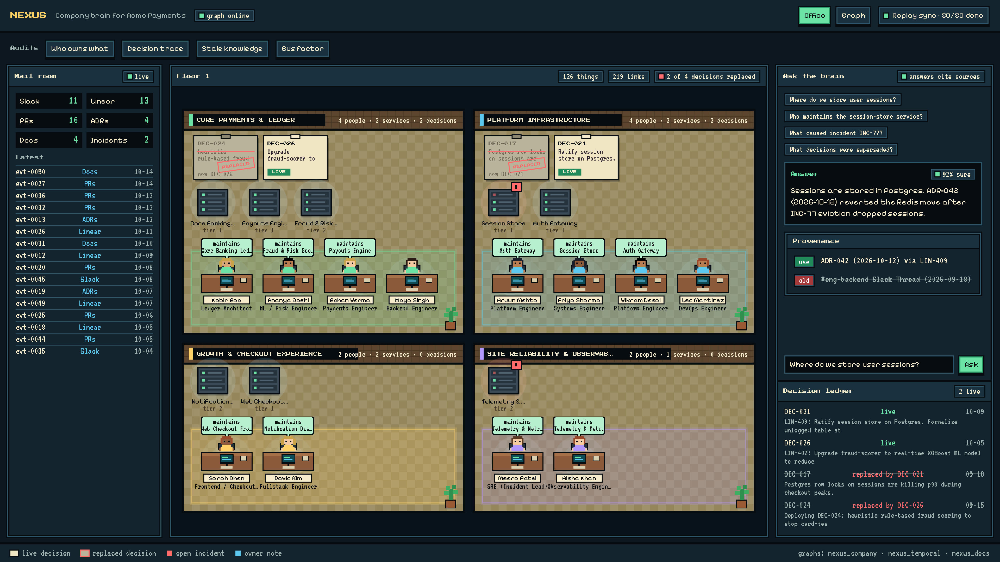

# NEXUS

**Organizational telemetry and decision graph.** NEXUS ingests Slack, Linear, GitHub, incidents and ADRs into FalkorDB, tracks which decisions superseded which, and answers questions with provenance, so engineers do not act on stale decisions.



*Office view: teams are rooms, people sit at desks with a note on what they own, services are server racks, decisions are wall boards. Superseded decisions are stamped REPLACED. The Graph toggle switches to the force-directed topology (see [docs/img/hud.png](docs/img/hud.png)).*

## Why

Flat vector search over team history returns superseded answers. A migration to Redis from last quarter ranks as high as the incident and ADR that reversed it. NEXUS models decisions as a bi-temporal graph. Superseded decisions stay queryable but are flagged, so answers use current state and cite both.

## Features

- **Multi-graph store:** `nexus_company` (entities and decisions), `nexus_temporal` (bi-temporal facts), `nexus_docs` (ADRs and runbooks), isolated per `org_id`.
- **Event ingest:** idempotent projection of source events into typed nodes with provenance back-links.
- **Supersession engine:** detects reversals and sets `invalid_at` on older decisions.
- **Four audits:** who owns what, decision trace, stale knowledge, bus factor.
- **Ask agent:** routes a question, runs multi-hop Cypher, validates against the graph, and returns current and superseded sources.
- **HUD:** Next.js dashboard with an office floor-plan view and a live force-graph topology (superseded edges dashed red, active edges green), audit bar, ask panel and live sync via SSE.
- **Zero-key mode:** `MOCK_EXTERNALS=true` runs everything offline with deterministic extractors.

## Repository layout

```
.
├── api/            FastAPI service (nexus_api/), unit and integration tests
├── web/            Next.js office HUD (/nexus)
├── fixtures/       Synthetic Acme Payments data: events, people, services, docs, gold questions
├── scripts/        Seed, replay, evaluate and reset tooling
├── docs/           Architecture, API, decisions, contract checks, build spec
├── .github/        CI workflow
├── docker-compose.yml
├── Makefile
└── MODIFICATIONS.md  History note on the removed upstream FalkorDB Browser code
```

## Quickstart

Requires Docker with Compose, Node.js 20+, Python 3.11+ and [`uv`](https://docs.astral.sh/uv/).

```bash
cp .env.example .env     # defaults run in zero-key mode
make up                  # FalkorDB, API, web, MCP server
(cd api && uv run python ../scripts/seed.py --until 2026-09-30)   # pre-incident state
open http://localhost:3000/nexus
```

Demo flow:

1. Note `DEC-017` (sessions in Redis) shown as an active, green edge.
2. Run **Bus Factor** from the audit bar.
3. Click **Simulate Sync**. As `INC-77` and `PR-1184` stream in, `DEC-017` turns red and dashed, and `DEC-021` appears as active.
4. Ask *"Where do we store user sessions?"*. The answer cites `ADR-042` as current and `ADR-038` as superseded.

| Service | URL |
|---|---|
| Web HUD | http://localhost:3000/nexus |
| API and OpenAPI docs | http://localhost:8000/docs |
| FalkorDB | `localhost:6379` |
| MCP server | http://localhost:8080 |

## Development

```bash
make setup    # create .env, uv sync, npm ci
make test     # api pytest and web unit tests
make lint     # ruff, mypy, eslint
make eval     # NEXUS vs flat BM25 benchmark
make reset    # wipe graphs and local run history
```

API unit tests need no services: `cd api && uv run pytest tests/unit`. Integration tests need a running FalkorDB.

## Configuration

All settings are environment variables. See [`.env.example`](.env.example).

| Variable | Default | Purpose |
|---|---|---|
| `MOCK_EXTERNALS` | `true` | Offline mode. Set `false` to use a live LLM. |
| `NEXUS_ORG_ID` | `acme` | Tenant id stored on every node. |
| `FALKORDB_HOST` / `FALKORDB_PORT` | `localhost` / `6379` | Graph database. |
| `OPENAI_API_KEY` / `GOOGLE_API_KEY` | empty | Needed only when `MOCK_EXTERNALS=false`. |
| `ADMIN_TOKEN` | `change-me` | Guards destructive routes. **Change it outside local development.** |
| `NEXUS_API_URL` | `http://localhost:8000` | API address the web app proxies to. Set at build time in Docker. |
| `CORS_ORIGINS` | `http://localhost:3000` | Allowed browser origins. |

## Benchmark

`make eval` runs the 10 gold questions in `fixtures/company/gold_questions.json` against NEXUS and a flat BM25 RAG baseline. The questions are built to catch systems that ignore supersession.

| Metric | NEXUS (Graph-Temporal) | FLAT-RAG (BM25 Top-3 Raw) | Evaluation Significance |
|---|---|---|---|
| **`current_answer_accuracy`** | **1.00** | **0.00** | Flat RAG retrieves raw chunks asserting superseded facts; NEXUS retrieves current state. |
| **`stale_answer_rate`** | **0.00** | **0.50** | **50% of Flat RAG answers advocate dead/superseded architectures** (e.g., advising Redis for sessions). NEXUS has 0.00 stale answers. |
| **`answers_with_sources`** | **1.00** | **1.00** | Both systems return source citations. |
| **`superseded_sources_flagged`**| **1.00** | **0.00** | **NEXUS explicitly warns the engineer that past sources are superseded**; Flat RAG cannot distinguish active from invalid. |
| **`p95_latency_ms`** | **22.7 ms** | **0.2 ms** | NEXUS traverses multi-graph Cypher & bi-temporal fact edges in **<25ms**; both well within interactive thresholds. |

Latency figures come from a local run in mock mode.

## Documentation

| Doc | Contents |
|---|---|
| [docs/ARCHITECTURE.md](docs/ARCHITECTURE.md) | System diagram, ingest sequence, supersession lifecycle, graph schema, code layout |
| [docs/API.md](docs/API.md) | Endpoint reference |
| [docs/DECISIONS.md](docs/DECISIONS.md) | Engineering decision log |
| [docs/CONTRACTS.md](docs/CONTRACTS.md) | Verified integration contracts with upstream libraries |
| [docs/BUILD_SPEC.md](docs/BUILD_SPEC.md) | Original build specification |

## Privacy and security

- All fixture data is synthetic.
- People nodes store `email_hash`, not plaintext email.
- `DELETE /api/sources/{event_id}` erases a source event and nodes derived only from it, and tombstones matching temporal facts.
- API keys and bearer tokens are masked in logs and stored run previews.
- The default `ADMIN_TOKEN` is a development placeholder. There is no user login: put the app behind your own auth proxy before exposing it.

## Limitations

1. **Simulated connectors.** Events arrive as webhook-style payloads or JSONL replay, not live Slack or Linear OAuth.
2. **Fact extraction.** In mock mode, temporal facts are mapped deterministically. In live mode, quality depends on the configured LLM.
3. **Docs search.** Without embedder keys, `nexus_docs` search uses graph metadata, section nodes and keyword scoring.

## Built on

- `web/` started as a fork of [FalkorDB Browser](https://github.com/FalkorDB/falkordb-browser) v2.3.1 (ELv2 / SSPL). The upstream code has since been removed; see [MODIFICATIONS.md](MODIFICATIONS.md). The upstream [LICENSE](web/LICENSE.txt) is kept.
- UI design language (chunky pixel panels, three-font pixel type system) is inspired by [Munder Difflin](https://github.com/HarnessMD/munder-difflin) (MIT), used with the author's permission. No code or art assets were copied. Fonts: Press Start 2P, Pixelify Sans and VT323 (SIL OFL) via `@fontsource`.
- [FalkorDB](https://github.com/FalkorDB/FalkorDB), [Graphiti](https://github.com/getzep/graphiti) (Apache-2.0), [GraphRAG-SDK](https://github.com/FalkorDB/GraphRAG-SDK), [react-force-graph](https://github.com/vasturiano/react-force-graph).
