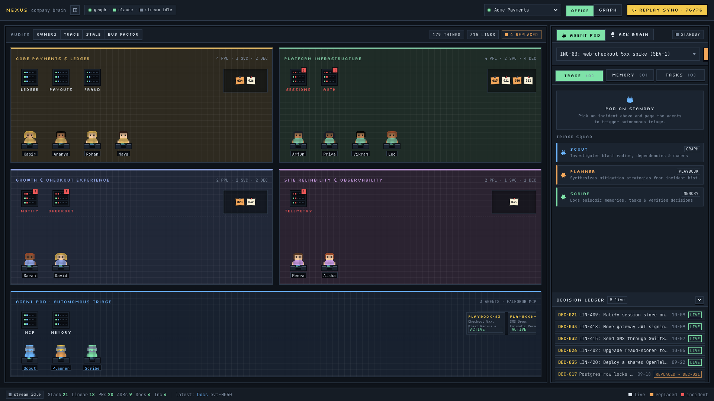
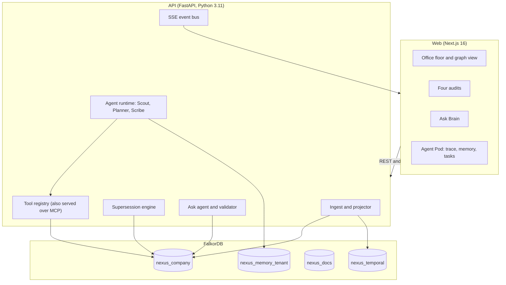
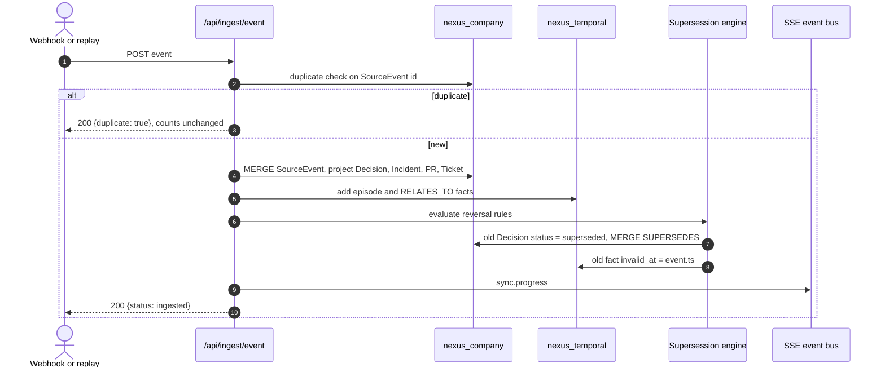

# NEXUS

A company brain on FalkorDB. NEXUS ingests Slack, Linear, GitHub, incidents and ADRs into one graph, tracks which decisions replaced which, answers questions with sources, and runs a small team of agents that investigate incidents over the same graph and remember what they did.



*Office view: teams are rooms, people sit at desks, services are server racks, decisions are wall boards. Replaced decisions are stamped REPLACED. The Graph toggle shows the same data as a clustered graph ([assets/decision-graph.png](assets/decision-graph.png)).*

## Why

Flat vector search over team history returns stale answers. A Redis migration from last quarter ranks as high as the incident and ADR that reversed it. NEXUS models decisions as a bi-temporal graph. Replaced decisions stay queryable but are flagged, so answers use current state and cite both.

## What it does

- **Company brain.** Events become typed nodes (people, teams, services, decisions, incidents, PRs, tickets) with links back to their source. A supersession engine sets `invalid_at` on older decisions when a newer one reverses them. Four audits (who owns what, decision trace, stale knowledge, bus factor) are single Cypher queries.
- **Ask Brain.** A router finds the entities in a question, graph context is read from FalkorDB, and a model writes the answer from that context only. Every cited id is checked against the graph, and replaced sources move out of the "current" list. Without a key, answers are built from the graph directly.
- **Agents that act.** Scout, Planner and Scribe handle an incident in turn: blast radius over `DEPENDS_ON`, PageRank criticality, owners, the newest live decision that affects the service or its dependencies, then they flag that decision, page the owner and open a ticket. Each tool call is stored with its Cypher, row count and latency.
- **Agent memory.** Native FalkorDB memory per tenant: episodes, facts with validity times, procedural playbooks, tasks with atomic claims and handoffs, conversation turns and tool-call traces.
- **MCP.** The agent tool registry is exposed over the Model Context Protocol at `/api/mcp`. The `falkordb/mcpserver` container also runs beside the API for schema and read-only queries.
- **Live office.** While events stream in, people react, envelopes fly to the service or decision they concern, incidents ring the rack, and replaced boards get stamped. Motion is off under `prefers-reduced-motion`.

What the agents do not do: they run their tools in a fixed order, and the graph (not a model) picks which decision to review. A recalled playbook is shown but does not skip steps. The model only writes Ask Brain answers.

## Quickstart

Requires Docker with Compose.

```bash
cp .env.example .env     # defaults run offline; add GROQ_API_KEY for model answers
make up                  # builds and starts FalkorDB, API, web and the MCP server
make seed                # loads the full sample company (76 events)
open http://localhost:3000
```

For a replay, run `make baseline` instead. It loads the company as of Sep 30 plus sample agent memory. Then click **Replay Sync** in the UI: as `INC-77` and `PR-1184` stream in, `DEC-017` (sessions in Redis) is stamped replaced and `DEC-021` appears.

Things to try:

1. Ask *"Where do we store user sessions?"*. The answer cites `ADR-042` as current and `ADR-038` as superseded.
2. Run **Bus factor** from the audit bar.
3. Open **Agent Pod**, pick `INC-83`, click **Page Agents**, and expand a trace step to see its Cypher.
4. Open the **Tasks** and **Memory** tabs, then run `INC-84` and look for the playbook chip.
5. Switch the tenant to **Globex**. Its memory graph is separate from Acme's.

Port in use? Set `NEXUS_FALKORDB_PORT`, `NEXUS_API_PORT`, `NEXUS_WEB_PORT` or `NEXUS_MCP_PORT` before `make up`.

| Service | URL |
|---|---|
| Landing page | http://localhost:3000 |
| Office | http://localhost:3000/nexus |
| API and OpenAPI docs | http://localhost:8000/docs |
| FalkorDB | `localhost:6379` |
| NEXUS MCP tools | http://localhost:8000/api/mcp/tools |
| FalkorDB MCP container | `localhost:8080` (`NEXUS_MCP_PORT`; another app may already use 8080) |

### Model answers

```bash
echo 'GROQ_API_KEY=gsk_...' >> .env     # .env is git-ignored
docker compose up -d api                # restart so the API reads the key
```

The header chip changes from "offline answers" to the model name and each answer shows a model badge. The model gets decisions, owners, incidents and the best-matching events from FalkorDB. If the key is wrong or the call fails, the app falls back to offline answers and marks the answer `degraded`. Groq's free tier allows about 8,000 tokens a minute, so space out questions.

## Architecture



Run history and step telemetry go to SQLite (`var/nexus.db`, git-ignored).

### Ingest and supersession



### How a question is answered

1. The router extracts intents and entities.
2. With a key set, `services/graph_context.py` reads relevant decisions, owners, incidents and source events from `nexus_company`. The model writes a structured answer from that context only (`agents/prompts/answer.md`).
3. `validate_and_filter_sources` drops ids that are not graph nodes and moves replaced sources out of the current list.
4. Without a key, scripted answers and `graph_fallback` build the answer from the decisions that affect the service or topic in the question.

### Agent run

Steps in order: `blast_radius`, `who_owns`, `criticality_rank`, `find_implicated_decisions`, `decision_trace`, `recall`, `flag_decision_for_review`, `page_owner`, `open_ticket`, `remember`. Scout creates a task and hands it to Planner, who hands it to Scribe. Handoffs are `HANDOFF` edges and the task claim is atomic. Each step publishes `agent.step` and `task.handoff` events that the Agent Pod shows live.

## Data model

FalkorDB holds several graphs in one instance. `org_id` isolates tenants in the company graphs; memory uses one graph per tenant.

| Graph | Purpose |
|---|---|
| `nexus_company` | Entities, topology, decisions, incidents |
| `nexus_temporal` | Bi-temporal facts |
| `nexus_docs` | ADRs and runbooks |
| `nexus_memory_<tenant>` | Agent memory, tasks, traces |

### `nexus_company`

| Label | Key properties |
|---|---|
| `Person` | `id`, `name`, `role`, `email_hash`, `org_id` |
| `Team` | `id`, `name` |
| `Service` | `id`, `name`, `tier`, `description` |
| `Project` | `id`, `name`, `status` |
| `Decision` | `id`, `title`, `status` (`active`, `superseded`), `summary`, `decided_at` |
| `Incident` | `id`, `title`, `severity`, `suspected_cause`, `created_at` |
| `PullRequest` | `id`, `title`, `author_id`, `merged_at` |
| `Ticket` | `id`, `title`, `status`, `assignee_id` |
| `Document` | `id`, `title`, `path`, `status` |
| `SlackThread` | `id`, `channel`, `author_id`, `ts` |
| `SourceEvent` | `id`, `kind`, `source`, `raw_payload`, `ts` |

| Relationship | Meaning |
|---|---|
| `(:Person)-[:MEMBER_OF]->(:Team)` | Team membership |
| `(:Team)-[:OWNS]->(:Service \| :Project)` | Ownership |
| `(:Person)-[:MAINTAINS]->(:Service)` | Primary maintainer |
| `(:Service)-[:DEPENDS_ON]->(:Service)` | Runtime dependency |
| `(:Decision)-[:SUPERSEDES]->(:Decision)` | Reversal |
| `(:Incident)-[:TRIGGERED]->(:PullRequest)` | Remediation link |
| `(:Decision)-[:DOCUMENTED_IN]->(:Document)` | ADR link |
| `(:Decision)-[:IMPLEMENTED_BY]->(:PullRequest)` | Implementation |
| `(:Decision)-[:TRACKED_BY]->(:Ticket)` | Ticket link |
| `(:Decision \| :Incident)-[:AFFECTS]->(:Service)` | Impact |
| `(:Person)-[:KNOWS_ABOUT]->(:Service \| :Decision)` | Expertise |

### `nexus_temporal`

`Episodic` (`uuid`, `name`, `body`, `reference_time`) and `Entity` (`name`), linked by `MENTIONS` and `RELATES_TO {uuid, name, fact, valid_at, invalid_at, episodes}`. A reversal sets `invalid_at` on the old fact.

### `nexus_docs`

`Document` (`id`, `title`, `path`, `status`, `summary`) and `Section` (`id`, `title`, `content`), linked by `SECTION_OF`, `SUPERSEDES` and `DOCUMENTS`.

### `nexus_memory_<tenant>`

| Label | Key properties |
|---|---|
| `Episode` | `id`, `incident_id`, `goal`, `outcome`, `ts` |
| `Fact` | `id`, `subject`, `predicate`, `object`, `valid_at`, `invalid_at`, `status` |
| `Procedure` | `id`, `trigger_pattern`, `tool_sequence`, `success_count`, `last_used` |
| `Task` | `id`, `title`, `status` (`open`, `claimed`, `completed`), `assigned_to` |
| `Conversation`, `Turn` | Conversation history per user |
| `AgentRun`, `ToolCall` | Trace: tool, args, Cypher, row count, latency |
| `Action` | Ticket, page or decision flag the agents wrote |

Relationships: `HAS_TURN`, `STEP` (run to tool call), `TOUCHED` (tool call or episode to entity), `HANDOFF`, `PRODUCED`, and `SUPERSEDES` between facts.

## Queries and algorithms

All Cypher lives in `api/nexus_api/cypher/*.cypher` or next to the service that uses it. The ones the product depends on:

```cypher
// Criticality: PageRank over service dependencies
CALL algo.pageRank('Service', 'DEPENDS_ON')
YIELD node, score
RETURN node.id AS service, node.name AS name, score
ORDER BY score DESC

// Bridges: betweenness centrality
CALL algo.betweenness()
YIELD node, score
WHERE 'Service' IN labels(node)
RETURN node.id AS service, score ORDER BY score DESC LIMIT 5

// Blast radius: everything that depends on a failing service
MATCH path = (root:Service {id: $service_id, org_id: $org_id})<-[:DEPENDS_ON*1..4]-(down:Service)
RETURN down.id AS affected_service, length(path) AS depth
ORDER BY depth ASC

// Bus factor: services with a single maintainer
MATCH (p:Person {org_id: $org_id})-[:MAINTAINS]->(s:Service {org_id: $org_id})
WITH s, collect(p) AS maintainers, count(p) AS n
WHERE n = 1
RETURN s.id AS service_id, maintainers[0].name AS sole_maintainer

// Decision trace: up to three SUPERSEDES hops, with PRs and incidents
MATCH (d:Decision {id: $decision_id, org_id: $org_id})
OPTIONAL MATCH (d)-[:SUPERSEDES*1..3]->(old:Decision)
OPTIONAL MATCH (d)<-[:IMPLEMENTED_BY]-(pr:PullRequest)
OPTIONAL MATCH (pr)<-[:TRIGGERED]-(inc:Incident)
RETURN d.id, d.status, collect(DISTINCT old.id) AS superseded,
       collect(DISTINCT pr.id) AS pull_requests, collect(DISTINCT inc.id) AS incidents

// Ownership
MATCH (s:Service {id: $service_id, org_id: $org_id})
OPTIONAL MATCH (t:Team)-[:OWNS]->(s)
OPTIONAL MATCH (p:Person)-[:MAINTAINS]->(s)
RETURN s.id, t.name AS team, collect(DISTINCT p.name) AS maintainers
```

Memory queries:

```cypher
// Atomic task claim: only one agent wins
MATCH (t:Task {id: $task_id, status: 'open'})
SET t.status = 'claimed', t.assigned_to = $agent_id, t.claimed_at = $ts
RETURN t.id

// Episode recall by entity overlap
MATCH (ep:Episode)-[:TOUCHED]->(ent:EntityRef)
WHERE ent.id IN $entities
OPTIONAL MATCH (ep)-[:PRODUCED]->(p:Procedure)
RETURN ep.id, ep.incident_id, ep.outcome, count(ent) AS overlap, p.tool_sequence
ORDER BY overlap DESC, ep.ts DESC LIMIT 3

// Fact supersession: a new belief invalidates the old one
MATCH (f:Fact {subject: $subj, predicate: $pred, status: 'active'})
SET f.status = 'superseded', f.invalid_at = $ts

// Run trace
MATCH (run:AgentRun {id: $run_id})-[:STEP]->(tc:ToolCall)
OPTIONAL MATCH (tc)-[:TOUCHED]->(node)
RETURN tc.step_number, tc.tool, tc.cypher, tc.rows_count, tc.latency_ms,
       collect(DISTINCT coalesce(node.id, node.name)) AS touched
ORDER BY tc.step_number
```

## Agent tools and MCP

Tools are plain functions with JSON schemas in `api/nexus_api/agents/tools.py`. Each returns `{result, cypher, rows, ms}`.

| Tool | What it does |
|---|---|
| `blast_radius` | Variable-length `DEPENDS_ON` walk and BFS from a failing service |
| `who_owns` | Team, maintainers and experts for a service |
| `criticality_rank` | `algo.pageRank` and `algo.betweenness` over `DEPENDS_ON` |
| `find_implicated_decisions` | Two-hop `AFFECTS` and `DEPENDS_ON` search for the newest live decision |
| `decision_trace` | `SUPERSEDES` chain, PRs and incidents for a decision |
| `find_experts` | People who `KNOWS_ABOUT` a service |
| `recall`, `remember` | Read and write agent memory |
| `flag_decision_for_review`, `page_owner`, `open_ticket` | Write `Action` nodes |

`api/nexus_api/mcp_server.py` serves the same registry with the official `mcp` SDK at `/api/mcp`. Any MCP client, for example `npx @modelcontextprotocol/inspector`, can list and call the tools.

## API

Base URL `http://localhost:8000`, interactive docs at `/docs`. Handlers are in `api/nexus_api/routes/`.

Auth: reads are open. `POST /api/admin/reset`, `DELETE /api/sources/{event_id}` and `POST /api/sync/simulate` with `reset=true` need `X-Admin-Token` (403 otherwise). If `INGEST_TOKEN` is set, `POST /api/ingest/event` needs `X-Ingest-Token` (401 otherwise). Memory and agent routes read the tenant from `X-Tenant` (default `acme`). If FalkorDB is down, graph routes return 503.

| Method | Path | Description |
|---|---|---|
| `GET` | `/health`, `/api/health` | Liveness, graph counts, `llm.mode` (`groq`, `claude`, `openai`, `scripted`) |
| `POST` | `/api/ingest/event` | Ingest one event. Idempotent on event id |
| `POST` | `/api/audits/who-owns-what` | Ownership audit |
| `POST` | `/api/audits/decision-trace` | Decision lineage. Optional `{decision_id, service_id}` |
| `POST` | `/api/audits/stale-knowledge` | Active versus replaced sources |
| `POST` | `/api/audits/bus-factor` | Bus factor and expertise |
| `POST` | `/api/ask` | `{question, as_of?}` returns `answer`, `current_sources`, `superseded_sources`, `path`, `owners`, `confidence`, `degraded`, `mode`, `model` |
| `GET` | `/api/provenance/{decision_id}` | Lineage for a decision |
| `GET` | `/api/graph/topology` | Nodes and edges for the views |
| `GET` | `/api/graph/temporal/edges` | Bi-temporal fact edges |
| `POST` | `/api/sync/simulate` | Replay `fixtures/company/events.jsonl`. 409 if a run is active |
| `GET` | `/api/sync/status` | Progress of the active or latest run |
| `POST` | `/api/sync/cancel` | Cancel the run |
| `GET` | `/api/events/stream` | Server-Sent Events: `sync.progress`, `ingest.received`, `agent.step`, `task.handoff`, `agent.completed` |
| `GET` | `/api/sources` | List source events |
| `DELETE` | `/api/sources/{event_id}` | Erase a source event and nodes derived only from it |
| `GET` | `/api/runs`, `/api/runs/{run_id}` | Run history and step trace |
| `POST` | `/api/agents/run` | Run Scout, Planner, Scribe on an incident |
| `GET` | `/api/agents/incidents` | Sample incidents to page agents with |
| `GET` | `/api/agents/runs/{run_id}` | Trace of one agent run |
| `GET` | `/api/agents/tasks` | Task handoff chain |
| `GET` | `/api/memory/episodes`, `/facts`, `/procedures`, `/history` | Agent memory for the tenant |
| `POST` | `/api/admin/reset` | Reset graphs and run history |
| `GET` | `/debug` | Debug console: telemetry waterfall and Cypher |

## Repository layout

```
.
├── api/            FastAPI service (nexus_api/), unit and integration tests
│   └── nexus_api/  main, config; routes/ handlers; services/ business logic;
│                   adapters/ FalkorDB, temporal, docs RAG, LLM; agents/ router,
│                   tools, runtime; memory/ store; cypher/ queries; models/
├── web/            Next.js app: landing page and /nexus office
│   ├── app/        pages and CSS
│   ├── components/ landing/ and nexus/ (OfficeFloor, LiveTopology, AgentPanel, AskPanel, ...)
│   └── lib/nexus/  typed API client, room layout (office.ts), graph layout, SSE hooks
├── fixtures/       Synthetic data: company (events, people, services, incidents, docs, gold questions), globex
├── scripts/        seed, seed_memory, replay, eval, loadtest, reset, stories
├── assets/         README images
├── docker-compose.yml, Makefile, .env.example
└── .github/        CI workflow
```

`web/next.config.js` proxies `/api/nexus/*` and `/api/events/stream` to the API at `NEXUS_API_URL` (read at build time).

## Development

```bash
make setup      # create .env, uv sync, npm ci
make test       # api and web unit tests, no services needed
make lint       # ruff, mypy, eslint
make eval       # NEXUS vs flat BM25 benchmark, run in the API container
make reset      # wipe graphs and run history
make logs       # follow container logs
make down       # stop the stack
```

Run the API locally: `cd api && uv sync && uv run uvicorn nexus_api.main:app --reload --port 8000` (needs FalkorDB on `FALKORDB_HOST:FALKORDB_PORT`). Run the web app: `cd web && npm ci && npm run dev`. API unit tests need no services: `cd api && uv run pytest tests/unit`. Integration tests need FalkorDB and **reset its graphs**, so point them at a scratch instance. Live Graphiti extraction (`MOCK_EXTERNALS=false`) needs `uv sync --extra live`, which pulls in PyTorch. Browser tests: `cd web && npx playwright test`.

## Configuration

All settings are environment variables; see [.env.example](.env.example).

| Variable | Default | Purpose |
|---|---|---|
| `MOCK_EXTERNALS` | `true` | Offline mode with deterministic extractors. `false` uses a live LLM |
| `NEXUS_ORG_ID` | `acme` | Tenant id stored on every node |
| `FALKORDB_HOST` / `FALKORDB_PORT` | `localhost` / `6379` | Graph database |
| `GROQ_API_KEY` | empty | Live answers through Groq. Restart the API after setting it |
| `GROQ_MODEL` | `openai/gpt-oss-120b` | Groq model |
| `ANTHROPIC_API_KEY` / `ANTHROPIC_MODEL` | empty / `claude-sonnet-5-5` | Alternative provider |
| `LLM_PROVIDER` | `groq` | Preferred engine when several keys are set (`groq`, `anthropic`, `openai`) |
| `OPENAI_API_KEY` / `GOOGLE_API_KEY` | empty | Optional OpenAI provider and live graph extraction |
| `ADMIN_TOKEN` | `change-me` | Needed as `X-Admin-Token` on reset, source deletion and `reset=true` replays. **Change it outside local development** |
| `INGEST_TOKEN` | empty | When set, `POST /api/ingest/event` requires it |
| `NEXUS_API_URL` | `http://localhost:8000` | API address the web app proxies to (build time) |
| `CORS_ORIGINS` | `http://localhost:3000` | Allowed browser origins |

## Benchmarks

`make eval` runs the 12 gold questions in `fixtures/company/gold_questions.json` against NEXUS and a flat BM25 baseline. The questions are built to catch systems that ignore supersession.

| Metric | NEXUS | Flat BM25 top-3 |
|---|---|---|
| `current_answer_accuracy` | 1.00 | 0.08 |
| `stale_answer_rate` | 0.00 | 0.42 |
| `answers_with_sources` | 1.00 | 1.00 |
| `superseded_sources_flagged` | 1.00 | 0.00 |
| `p95_latency_ms` | about 23 | about 0.4 |

Memory load test: `uv run --project api python scripts/loadtest.py --workers 20 --operations 200` runs 200 agent sessions (1,400 graph operations: reads, task claims, handoffs, episode writes) against FalkorDB. On one laptop it measured about 1,000 to 2,700 ops/sec depending on machine load, p95 session latency 30 to 200 ms, and zero double-claims across 200 concurrent task claims.

Stop FalkorDB and the agent routes fail at once with `ConnectionError`: every tool runs Cypher against it.

## AI assistance

AI coding assistants (Google DeepMind AntiGravity and Claude Code) were used for scaffolding, architecture drafting, documentation and test orchestration. The author reviews and maintains the graph models, Cypher queries and code.

## Privacy and security

- All fixture data is synthetic.
- People nodes store `email_hash`, not plaintext email.
- `DELETE /api/sources/{event_id}` erases a source event and nodes derived only from it, and tombstones matching temporal facts.
- API keys and bearer tokens are masked in logs and stored run previews.
- The default `ADMIN_TOKEN` is a development placeholder. There is no user login: put the app behind your own auth proxy before exposing it.

## Limitations

1. **Simulated connectors.** Events arrive as webhook payloads or JSONL replay, not live Slack or Linear OAuth.
2. **Fact extraction.** In mock mode, temporal facts are mapped deterministically. In live mode, quality depends on the configured LLM.
3. **Docs search.** Without embedder keys, `nexus_docs` search uses graph metadata, section nodes and keyword scoring.
4. **Agents.** Fixed tool order; playbook reuse is recalled and shown, not used to skip steps.
5. **No login.** Tenants are selected by header, not authenticated.
