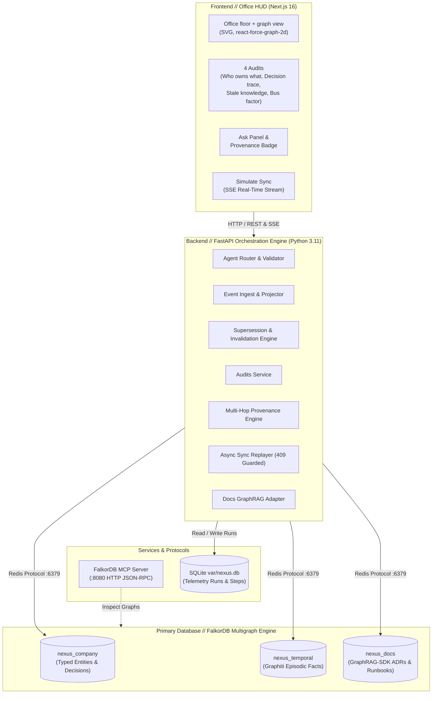
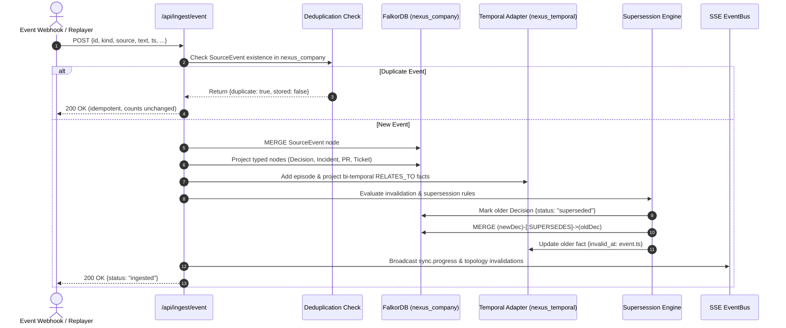
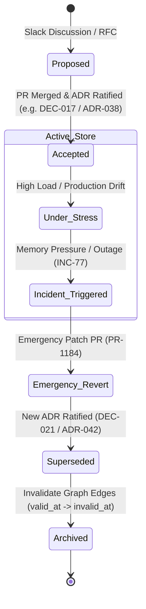

# Architecture

## System Architecture

---

## Ingest Pipeline & Decision Supersession Lifecycle

### Ingestion & Graph Projection Pipeline

### Decision Supersession Lifecycle State Machine

---

---

## FalkorDB Multigraph

NEXUS uses **FalkorDB** as its primary graph engine. Tenant isolation is enforced with an `org_id` property across three graphs:

| Graph | Purpose | Node types | Edge types | Source |
|---|---|---|---|---|
| `nexus_company` | Organization ontology, current topology, decisions. | `Person`, `Team`, `Service`, `Project`, `Decision`, `Incident`, `PR`, `LinearTicket`, `SourceEvent` | `OWNS`, `MAINTAINS`, `MEMBER_OF`, `SUPERSEDES`, `RESOLVES`, `TRIGGERED`, `DERIVED_FROM` | [`schema.cypher`](../api/nexus_api/cypher/schema.cypher) |
| `nexus_temporal` | Episodic memory and bi-temporal facts (`valid_at`, `invalid_at`, `expired_at`). | `Entity`, `Episodic` | `RELATES_TO {valid_at, invalid_at}`, `MENTIONS` | [`temporal.py`](../api/nexus_api/adapters/temporal.py) |
| `nexus_docs` | ADRs and runbooks indexed via GraphRAG-SDK. | `Document`, `Section` | `SECTION_OF`, `SUPERSEDES`, `DOCUMENTS` | [`docs_rag.py`](../api/nexus_api/adapters/docs_rag.py) |

Run and step telemetry is stored in SQLite (`var/nexus.db`, git-ignored). See [DECISIONS.md](DECISIONS.md) D-001.

## Quick Audits

Each audit is a single Cypher query in [`api/nexus_api/cypher/`](../api/nexus_api/cypher) and returns `nodes`, `edges`, `highlight_ids`, the executed `cypher`, and a `run_id`.

| Audit | Endpoint | Query | Answers |
|---|---|---|---|
| Who owns what | `POST /api/audits/who-owns-what` | `who_owns_what.cypher` | People mapped to the services and projects they own or maintain. |
| Decision trace | `POST /api/audits/decision-trace` | `decision_trace.cypher` | A decision, its sources, and the decisions it supersedes (up to 3 hops). |
| Stale knowledge | `POST /api/audits/stale-knowledge` | `stale_knowledge.cypher` | Decision-to-source edges with their active or superseded status. |
| Bus factor | `POST /api/audits/bus-factor` | `bus_factor.cypher` | People ranked by connection degree, with their service expertise. |

## Code Layout (`api/nexus_api/`)

| Path | Responsibility |
|---|---|
| `main.py`, `config.py` | App factory, router wiring, environment settings. |
| `routes/` | Thin HTTP handlers; no business logic. |
| `services/` | Ingest, projection, supersession, audits, provenance, ask agent, sync replay, tracing, event bus. |
| `adapters/` | FalkorDB, temporal graph, docs RAG, and LLM clients. Mock and live modes sit behind the same interface. |
| `agents/` | Question router and prompt templates. |
| `models/` | Pydantic models for the ontology, events, and API payloads. |
| `cypher/` | All Cypher kept as `.cypher` files. |

## How a question is answered

1. The router extracts intents and entities.
2. With `GROQ_API_KEY` (or `ANTHROPIC_API_KEY`) set, `services/graph_context.py` reads decisions, owners, incidents and the best-matching source events from `nexus_company`, and the model writes a structured answer from that context only (`agents/prompts/answer.md`).
3. `validate_and_filter_sources` drops any id that is not a node in the graph and moves superseded sources out of the current list.
4. Without a key, scripted answers cover the original demo questions and `graph_fallback` builds an answer from the decisions that affect the service or topic in the question.

