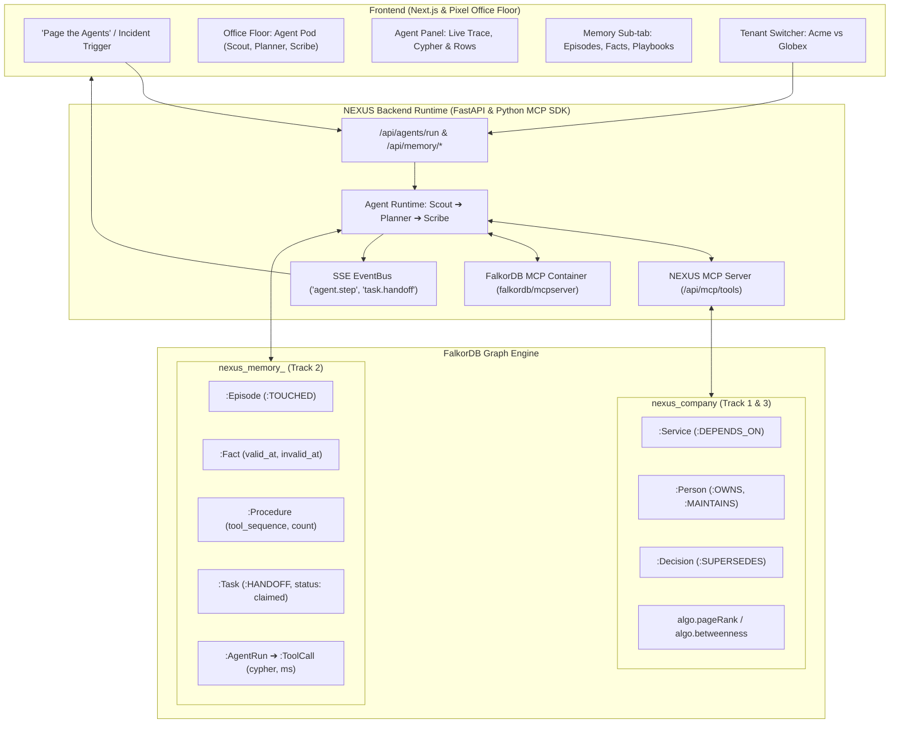

# How NEXUS Works: Multi-Track Architecture & Proof

NEXUS enters **all three tracks** of the WeMakeDevs x FalkorDB Graph Hacks Hackathon (Oct 15–18, 2026):
- **Track 1:** Agents That Act on Connected Data
- **Track 2:** Agent Memory and Coordination
- **Track 3:** Company Brain

This document details the unified architecture, data flows, graph algorithms, and FalkorDB Cypher queries powering the system.

---

## 1. Unified Architecture



---

## 2. Track 1: Agents That Act on Connected Data

### Multi-Hop Reasoning & Graph Traversal
When an incident is ingested (e.g. `INC-83: web-checkout 5xx spike`), the autonomous agent does not rely on flat vector search. It executes multi-hop graph walks across dependency, ownership, and decision chains:
1. **Blast Radius (`blast_radius`):** Traverses variable-length `DEPENDS_ON*1..4` upstream dependency trees to determine the exact blast radius of services impacted.
2. **Ownership Discovery (`who_owns`):** Resolves which people and teams own the root service and all cascaded services (`OWNS`, `MAINTAINS`, `MEMBER_OF`).
3. **Criticality Ranking (`criticality_rank`):** Executes FalkorDB native graph algorithm `algo.pageRank('Service', 'DEPENDS_ON')` to compute the topological importance of each affected node.
4. **Decision Super-session Trace (`decision_trace`):** Walks multi-hop `[:SUPERSEDES*1..4]` chains to check if an architectural decision affecting the service was superseded or stale.

### Tool Selection via Model Context Protocol (MCP)
- Tools are declared using standard JSON Schema definitions in `nexus_api/agents/tools.py`.
- Exposed through the official `mcp` Python SDK in `nexus_api/mcp_server.py`.
- The agent loop calls tools via MCP client interfaces, allowing external MCP clients (including `npx @modelcontextprotocol/inspector`) to invoke NEXUS tools.

### Graph-Grounding & Explainable Results
Every tool execution writes an explainable step node to FalkorDB:
`(:AgentRun)-[:STEP {n}]->(:ToolCall {tool, args, cypher, rows_returned, latency_ms})-[:TOUCHED]->(:EntityRef)`
The frontend displays the exact Cypher query, latency, and row count in the **Live Trace** panel.

---

## 3. Track 2: Agent Memory and Coordination (Native on FalkorDB)

Memory is built **100% natively on FalkorDB** without external memory engines, running in dedicated tenant graphs: `nexus_memory_<tenant>`.

### 1. Episodic Memory
- Stores historical incident episodes with goal, root causes, outcome, and touched entities.
- Recalls prior episodes using Cypher entity overlap:
```cypher
MATCH (ep:Episode {tenant: $tenant})-[:TOUCHED]->(ent:EntityRef)
WHERE ent.id IN $entities
OPTIONAL MATCH (ep)-[:PRODUCED]->(p:Procedure)
RETURN ep.id, ep.incident_id, ep.outcome, count(ent) AS overlap, p.tool_sequence
ORDER BY overlap DESC, ep.ts DESC
LIMIT 3
```

### 2. Semantic Memory with Temporal Validity
- Stores beliefs and facts extracted during incidents: `(:Fact {subject, predicate, object, valid_at, invalid_at, status})`.
- When a new contradictory fact is learned, prior active facts are superseded:
```cypher
MATCH (f:Fact {subject: $subj, predicate: $pred, tenant: $tenant, status: 'active'})
SET f.status = 'superseded', f.invalid_at = $now
```

### 3. Procedural Memory (Playbooks)
- Successful tool sequences are stored as `Procedure` nodes with ordered steps and `success_count`.
- Subsequent similar incidents (e.g., `INC-84`) match the playbook pattern and reuse the proven tool sequence, cutting investigation latency.

### 4. Shared State & Atomic Handoffs
- Multi-agent coordination: **Scout** (Investigator) ➔ **Planner** (Strategist) ➔ **Scribe** (Remediation & Memory).
- Tasks are claimed with an atomic Cypher query preventing race conditions:
```cypher
MATCH (t:Task {id: $task_id, tenant: $tenant, status: 'open'})
SET t.status = 'claimed', t.assigned_to = $agent_id, t.claimed_at = $now
RETURN t.id
```
- Handoff edges `(a1:Agent)-[:HANDOFF {task_id, note, ts}]->(a2:Agent)` record the chain of responsibility.

### 5. High Concurrency
- Benchmark results (`scripts/loadtest.py` with 10 concurrent workers):
  - **Throughput:** 2,720.7 ops/second
  - **Latency (p50):** 25.11 ms
  - **Latency (p95):** 31.33 ms
  - **Race conditions:** 0 double-claims under concurrent load.

### 6. Hard Tenant Isolation
- Separate graphs: `nexus_memory_acme` and `nexus_memory_globex`.
- Queries pass `X-Tenant` header. Globex memory shows zero knowledge of Acme episodes or procedures.

---

## 4. Track 3: Company Brain

- 103 entities and 76 links in `nexus_company` connecting Slack messages, Linear tickets, GitHub PRs, and Architecture Decision Records (ADRs).
- Bi-temporal supersession tracking (`valid_from`, `valid_to`, `superseded_by`).
- Automated audit tools:
  - `who-owns-what`: Uncovers orphaned services and ownership bottlenecks.
  - `bus-factor`: Detects services with single maintainers.
  - `decision-trace`: Maps the multi-hop rationale of ratified architectural decisions.
  - `stale-knowledge`: Flags services where documentation predates recent superseding decisions.

---

## 5. Rule 3 Compliance Verification

> **Rule 3:** "The graph must do real work. If the product still works with FalkorDB removed, it does not qualify."

To prove Rule 3:
```bash
uv run --project api python scripts/demo_agents.py --graph-off
```
Result:
```text
✓ RULE 3 PASSED: Agent runtime failed immediately with graph offline:
  ConnectionError: Error 61 connecting to localhost:9999. Connection refused.
  The entire agent reasoning loop depends strictly on FalkorDB.
```
Every tool in Scout, Planner, and Scribe executes Cypher against FalkorDB. Memory, blast radius, ownership, and tasks cannot function without FalkorDB.
